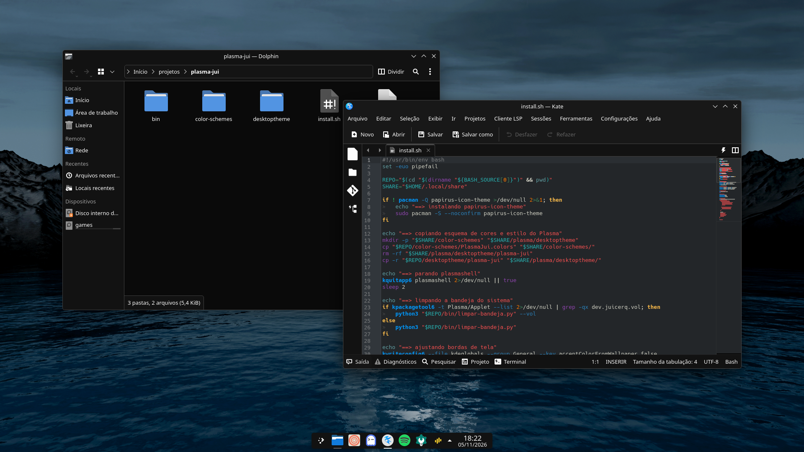
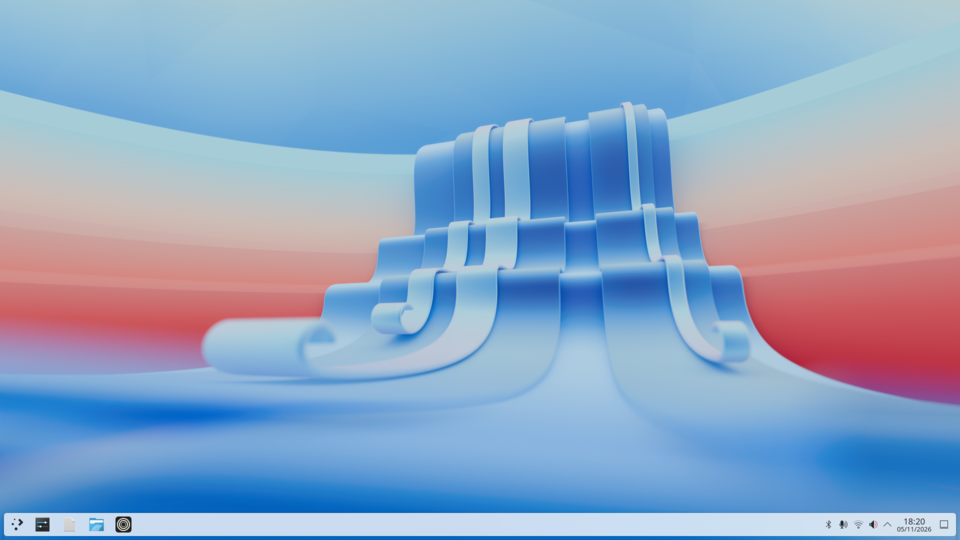
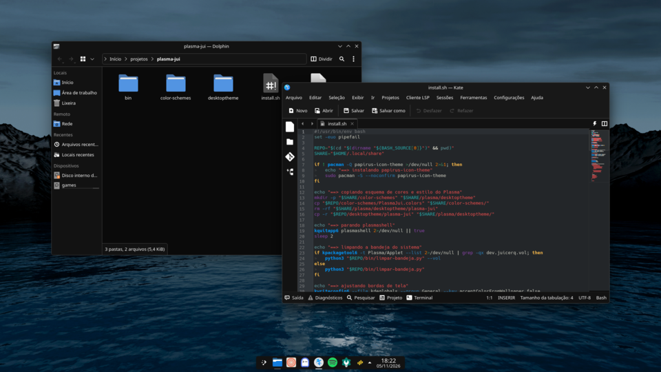
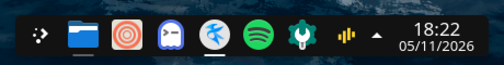

<div align="center">

# plasma-jui

**Tema preto e cinza para o KDE Plasma 6.**<br>
Painel flutuante e pequeno, barra de tarefas sem fundo e nenhuma cor fora do cinza.


<br>



</div>

<br>

## Destaques

- **Só cinza.** O esquema `PlasmaJui` vem do Breeze Dark com cada cor trocada pelo cinza de mesma luminância. Nenhum azul, verde ou vermelho sobra na interface.
- **Barra de tarefas sem fundo.** Cada app ganha uma linha curta embaixo do ícone. A opacidade da linha diz o estado do app.
- **Painel pequeno.** 38px, flutuante, no centro do rodapé. Some quando uma janela encosta nele.
- **Bandeja limpa.** Fica só o [Vol](https://github.com/juicerq/vol-app) e as notificações. O resto vai para o menu escondido.
- **Instala com um comando.** O `install.sh` aplica tudo e monta o painel por script.

## Antes e depois

<table>
  <tr>
    <td></td>
    <td></td>
  </tr>
  <tr>
    <td align="center"><sub>Plasma 6.7 padrão</sub></td>
    <td align="center"><sub>Depois do <code>./install.sh</code></sub></td>
  </tr>
</table>

As capturas vêm de uma sessão KWin virtual com o `install.sh` deste repositório e uma pasta pessoal vazia.

## Cores

| Elemento | Cor |
| --- | --- |
| Janelas | `#121212` |
| Listas e campos | `#0a0a0a` |
| Botões | `#202020` |
| Barras de título | `#181818` |
| Seleção | `#464646` |

Ícones: Papirus Dark.

## Barra de tarefas

O estilo do Plasma `plasma-jui` só troca o desenho da barra de tarefas. O fundo atrás de cada ícone sai. No lugar entra uma linha com metade da largura do ícone.

<p align="center"></p>

| Estado do app | Linha |
| --- | --- |
| Fechado (só lançador) | nenhuma |
| Minimizado | 25% |
| Aberto | 35% |
| Sob o mouse | 60% |
| Focado | 100% |
| Pedindo atenção | vermelha, 85% |

Os apps abertos não são agrupados: cada janela tem o próprio ícone.

## Notificações

As notificações aparecem no topo, ao centro, e somem em 3 segundos. Por padrão o Plasma as coloca junto do ícone da bandeja, que com o painel embaixo fica no rodapé. A barra de tarefas também não mostra contadores de notificação nos ícones.

<p align="center"></p>

## Instalar

Precisa de KDE Plasma 6 numa distribuição com `pacman`.

```sh
git clone https://github.com/juicerq/plasma-jui.git
cd plasma-jui
./install.sh
```

O script pede `sudo` uma vez, para instalar o `papirus-icon-theme`. Ele reinicia o `plasmashell` no meio do caminho. A sessão continua, só o painel pisca.

Se o [Vol](https://github.com/juicerq/vol-app) já estiver instalado, o script esconde o controle de volume do Plasma e deixa o Vol sempre visível. Sem o Vol, o controle de volume do Plasma continua na bandeja.

## Ajustar a linha

A linha da barra de tarefas é gerada por script. Edite as constantes no topo de `bin/gerar-tasks.py` e rode:

```sh
python3 bin/gerar-tasks.py
./install.sh
```

`LINE_HEIGHT` é a espessura. `LINE_WIDTH` dividido por `BOX_WIDTH` é a fração da largura do ícone. `OPACITY` guarda um valor por estado.

<details>
<summary>Desfazer</summary>

```sh
plasma-apply-colorscheme BreezeDark
plasma-apply-desktoptheme breeze-dark
/usr/lib/plasma-changeicons breeze-dark
kwriteconfig6 --file plasmanotifyrc --group Notifications --key PopupPosition --delete
kwriteconfig6 --file plasmanotifyrc --group Notifications --key PopupTimeout --delete
kwriteconfig6 --file plasmanotifyrc --group Badges --key InTaskManager --delete
```

O painel volta pelo botão direito nele → **Configurar painel**.

</details>

## Notas

O `plasma-org.kde.plasma.desktop-appletsrc` não fica no repositório. Ele guarda IDs de tela, o UUID da atividade e os apps fixados de cada máquina, e copiar esse arquivo entre máquinas quebra o painel. Por isso o `install.sh` monta o painel por comando.

Dois detalhes do Plasma 6.7 não têm opção de configuração:

- O painel escondido leva cerca de 500ms para sumir. O atraso é fixo no `plasmashell` e não depende da velocidade das animações. É o [bug 267277](https://bugs.kde.org/show_bug.cgi?id=267277), aberto desde 2011.
- O ícone sob o mouse fica mais claro. Esse efeito vem do QML compilado da barra de tarefas. O esquema atenua o efeito com `DecorationHover` em `#404040`, mas não dá para desligar.
